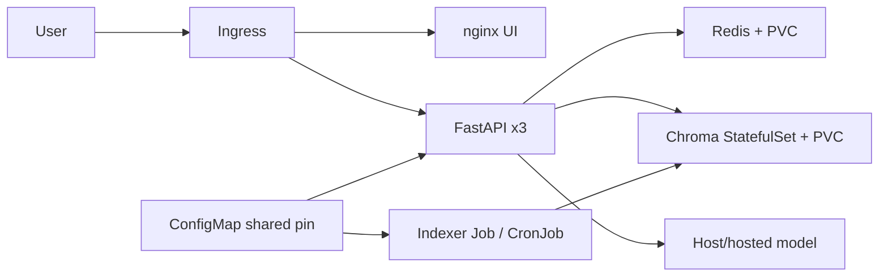

# RAHBAR architecture

Ingress routes / to nginx and /api to three FastAPI readers. Redis is their
persistent shared semantic cache. A one-replica Chroma StatefulSet owns a PVC
and stable network identity; a Deployment does not express that identity or
volumeClaimTemplate relationship. An independent indexer Job is the only writer.
Its weekly CronJob shares its command, arguments and lock PVC. EMBED_MODEL is
one ConfigMap key consumed by readers and writer.

Default-deny policies permit only required service paths and DNS. Model egress
needs an explicit host address rule before switching from dummy bootstrap.
Only ingress, API and indexer have the paths they need; UI cannot reach Chroma.
Pods have dedicated ServiceAccounts without API tokens, non-root UIDs,
read-only root filesystems, dropped capabilities and writable temp volumes.
Chroma disables Kubernetes service-link injection: otherwise the Service named
chroma injects CHROMA_PORT=tcp://..., conflicting with Chroma's numeric PORT.

Day 1 is a real Kubernetes deployment around dummy data and the supplied stub
provider. Real corpus generation, semantic cache and CI evaluation gates are
Day 2 requirements, not completed merely because their resources exist.
