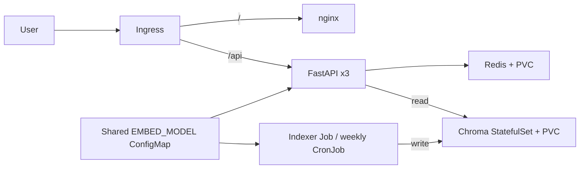

# RAHBAR


RAHBAR is a grounded question-answering service over public FAST-NUCES policies.
An independent indexer prepares versioned Chroma collections; three FastAPI
readers retrieve evidence and an nginx UI displays answers and citations.
The goal is honest, cited answers and abstention when documents do not cover a
question. **Day 1 status:** real extraction/indexing components and evaluation
calculations are implemented; the running Kubernetes demo still uses dummy
indexing and the supplied stub generator. Production grounding, semantic cache,
real generation evaluation and CD are not complete. See docs/REQUIREMENTS.md.

## Architecture



ARCHITECTURE.md and ADR 0001 explain the one-writer design, lock PVC and staged
publication. Day 1 CronJob is deliberately suspended while configured as dummy.
Do not enable it or describe stub output as a real grounded answer.

## Development environment

Use Linux/WSL 2 with Python 3.12, Git, Bash, Make and system Tesseract/Poppler.
This Windows workspace already has a Linux virtual environment. From WSL in
the project directory: `source .venv/rahbar-env.sh`. Do not activate that venv
using Windows Python. A new clone can use `make install`; paths with spaces
are supported by quoted Python executable paths in the Makefile.

```bash
make install
make test
make lint
cd api && ../.venv/bin/pytest --cov=app --cov-fail-under=60
```

Local `make dev` serves the UI and stub API on port 8000. Standalone stub asks
work without a model, but /readyz correctly needs configured Chroma/Redis.
Offline unit tests use fakes, including dependency-readiness and OCR paths.

## Corpus and reproducible indexing

Commit only public source URLs/checksums and the fetcher, not downloaded
third-party PDFs/HTML or extracted text. The selected eight documents contain
six PDFs with 194 pages plus fee/grading HTML. CORPUS.md maps all properties.

```bash
python corpus/fetch.py
python corpus/fetch.py --verify
python scripts/audit_corpus.py
# Set reachable OLLAMA_URL, CHROMA_HOST/PORT and the shared model pin.
cd indexer
CORPUS_DIR=../corpus/raw python -m pipeline.run
```

Default real embeddings use nomic-embed-text with matching API/query prefixes;
the local probe returns 768 dimensions. Chroma client/server both pin 1.0.12.
Document chunks preserve source, section, starting physical page, version and
superseded flag. Stable IDs are independent of random publication generations.
The lock path must reside on the shared lock volume for every cluster writer.

The 15 golden questions were committed before tuning. Run retrieval-only
experiments with `python scripts/chunk_experiment.py` after extraction and
reachable Ollama/Chroma setup. This does not establish a generation baseline.

## Kubernetes dummy bootstrap — exact apply order

Prerequisites: Docker Engine, kubectl, Minikube with enforcing Calico, ingress
and metrics-server. The laptop uses a 4 GiB node; measure rather than assuming
these initial requests/limits are final. The Makefile permits memory/CPU
overrides. On Windows, execute native Minikube commands with its actual profile
home; a stale MINIKUBE_HOME makes an existing cluster appear missing.

```bash
make cluster MINIKUBE_MEMORY=4096 MINIKUBE_CPUS=4
make images TAG=dev
kubectl apply -k k8s/overlays/dev
kubectl -n rahbar rollout status statefulset/chroma --timeout=240s
kubectl -n rahbar rollout status deployment/redis --timeout=180s
kubectl -n rahbar wait --for=condition=complete job/indexer --timeout=300s
kubectl -n rahbar rollout status deployment/api --timeout=180s
kubectl -n rahbar rollout status deployment/ui --timeout=180s
```

The Job's bounded init container waits for Chroma before spending its ingestion
retry budget. Bootstrap config is EMBED_MODEL=dummy-768, RETRIEVER=stub,
LLM_PROVIDER=stub. Only after indexing completes should API readiness pass.
The unapplied `secret.placeholder.yaml` must never overwrite a real Secret.

On Windows, use Minikube tunnel or forward the Ingress controller in another
terminal. The latter was verified for the Day 1 smoke:

```bash
kubectl -n ingress-nginx port-forward service/ingress-nginx-controller 18080:80
curl -H 'Host: rahbar.local' http://127.0.0.1:18080/
curl -H 'Host: rahbar.local' -H 'Content-Type: application/json' \
  -d '{"question":"Show the stub contract"}' http://127.0.0.1:18080/api/ask
```

Day 2 must mount the real corpus, remove --dummy from both Job templates,
configure tested model egress and set the shared real embedding pin. API
readiness rejects an empty/mismatched real publication. To reindex later:
`kubectl create job --from=cronjob/reindex manual-reindex-1 -n rahbar`.
The real writer stages a replacement before changing the active pointer.

## API contract

| Method | Endpoint | Purpose |
|---|---|---|
| GET | /healthz | Process liveness; no dependencies |
| GET | /readyz | Chroma/index/pin and Redis readiness; 503 on failure |
| GET | /metrics | Prometheus metrics; basic request metrics currently supplied |
| POST | /api/ask | JSON question, 3–500 characters; answer/citations/retrieved references |

Model reasoning is stripped from the API response. The UI uses textContent,
not untrusted innerHTML. Required extended metrics and real generation
guardrails remain tracked Day 2 tasks, not implied by these endpoint names.

## CI and evidence

ci.yml runs lint, types, offline tests with >=60% app coverage, strict production
Kustomize validation, gated image builds and a kind/Calico dummy bootstrap.
The fixture ConfigMap delivery groundwork is included; the bootstrap job is
explicitly not the Day 2 real retrieval/evaluation gate. No PR image publishing.
Trivy, real e2e quality gating and cd.yml remain required follow-up work.

docs/evidence contains real corpus audits, dummy indexer/Ingress output,
cluster resources, endpoints and resource samples. These are not fabricated
screenshots or final deployment claims. Required final screenshot, failure
experiments, rollback and successful CD links are still pending.

Run `python scripts/check_submission.py` from the repository root. Expected
Day 1 failures are tracked; a clean checker alone is never proof of quality.
See docs/AI-USAGE.md for actual AI assistance and human actions.
