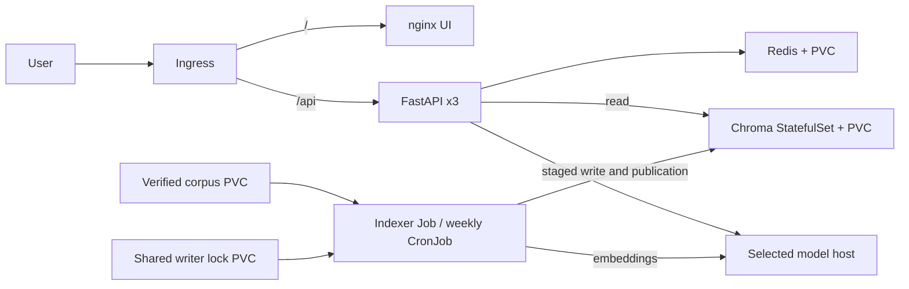
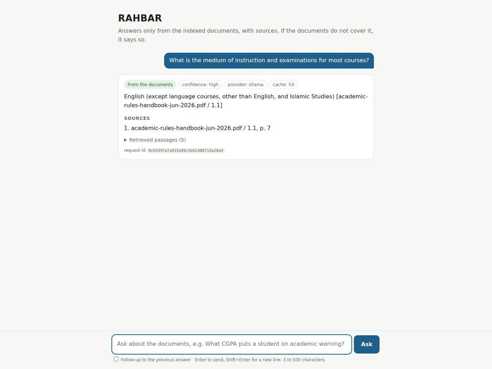

# RAHBAR — FAST-NUCES policy assistant


RAHBAR retrieves public university policies, generates cited answers and abstains
when evidence is missing. Eight documents include six PDFs with 194 physical
pages and genuinely changed 2023/2026 undergraduate policies. See
[provenance](docs/CORPUS.md), [pipeline](docs/PIPELINE.md) and
[requirement status](docs/REQUIREMENTS.md). The real golden evaluation passed (84.62% recall@5, 100% citation validity,
both must-abstain cases refused). The full corrected real-corpus cluster audit passed; the reviewed main release
is still pending. See the requirement record.

## Architecture



[Architecture](ARCHITECTURE.md) and four [ADRs](docs/adr) explain publication,
cache invalidation and providers. The API never indexes on startup.

## Clean clone and offline checks

Use Linux/WSL 2, Python 3.12, Git, Bash, Make, Docker, kubectl, Minikube,
Tesseract and Poppler. Real generation needs more memory than the laptop's
4 GiB node; remote acceptance is separate evidence. Allow disk space for
container layers, two Ollama models and OCR intermediates.

```bash
git clone https://github.com/rayyanhasan899/Rahbar.git
cd Rahbar
git checkout dev # use the reviewed main release after merge
make install PY=python3.12
source .venv/bin/activate
make test
python -m pytest eval/tests -q
make lint
python -m pip check
cd api && python -m pytest --cov=app --cov-fail-under=60 && cd ..
python scripts/check_submission.py
```

Installation uses a complete Python 3.12 wheel-hash lock. Install system OCR
packages through your operating system's package manager. This existing laptop
can instead source its inspected `.venv/rahbar-env.sh`; that machine-specific
file is not required by a new clone. Unit tests use fakes/mocked HTTP, with no
external services or models.

## Real corpus to first answer: exact apply order

Start a reachable Ollama service; pull `nomic-embed-text` and `llama3.2:3b`.
Use a trusted private listener accessible from the node. Host setting changes
need the owner's authorization. Verify its actual IPv4 address: provider egress
permits only that address on TCP 11434. The API and indexer share the model pin
and 768-dimensional embeddings.

```bash
make fetch
python corpus/fetch.py --verify
make cluster MINIKUBE_MEMORY=4096 MINIKUBE_CPUS=2
TAG=$(git rev-parse HEAD)
make images TAG="$TAG"
# Example for this Docker Desktop laptop; verify on a different host.
MODEL_IP=192.168.65.254
python scripts/deploy_local.py --tag "$TAG" \
  --provider-cidr "$MODEL_IP/32" --ollama "http://$MODEL_IP:11434"
```

The helper issues `kubectl apply` in this order: namespace, storage, Services, policies and dependencies first;
waits for Chroma/Redis; transfers hash-verified documents into the corpus PVC;
waits for a uniquely named real indexer Job; then rolls out API/UI, HPA and the
weekly CronJob. Do not wait for API readiness before first indexing. Existing
published collections are preserved. Base manifests select real indexing, not
dummy data. The Secret placeholder is deliberately excluded from Kustomize;
local Ollama requires no hosted key.

In a second terminal forward the Ingress:

```bash
kubectl -n ingress-nginx port-forward service/ingress-nginx-controller 18080:80
curl -H 'Host: rahbar.local' http://127.0.0.1:18080/
curl -H 'Host: rahbar.local' http://127.0.0.1:18080/api/version
curl -H 'Host: rahbar.local' -H 'Content-Type: application/json' \
  -d '{"question":"What is the maximum duration of a BS degree?"}' \
  http://127.0.0.1:18080/api/ask
```

For the browser, resolve `rahbar.local` to the forwarded address through approved
local DNS/hosts configuration, then visit `http://rahbar.local:18080`. Internal
HTTP is a [documented limitation](docs/SECURITY-REVIEW.md).

| Method | Endpoint | Purpose | Access |
|---|---|---|---|
| POST | /api/ask | Question and optional history | Ingress |
| GET | /api/version | Source revision | Ingress |
| GET | /healthz | Process liveness | API Service |
| GET | /readyz | Dependency and index readiness | API Service |
| GET | /metrics | Prometheus metrics | API Service |

`POST /api/ask` accepts `question` and optional `history`; `GET /api/version`
identifies the build. `/healthz`, `/readyz` and `/metrics` are API Service
endpoints, outside the `/api` Ingress route. Health has no dependency; readiness
checks published model/dimension and dependencies.

## Reindex and evaluation

```bash
make index
kubectl -n rahbar get jobs,pods,hpa
python eval/run_eval.py --api http://127.0.0.1:18080 --host rahbar.local
```

All index writers share a lock. Each builds a collection, validates it, then
publishes a generation pointer. Cache keys include generation; the indexer needs
no Redis access. The weekly Job reindexes the curated PVC snapshot rather than
silently downloading new policy versions. Update provenance and transfer a
verified snapshot before indexing changed documents. Do not overlap an
administrative corpus transfer with indexing.

Golden questions predate tuning. Recall is macro-averaged over nonempty labelled
relevance sets; empty relevance is excluded. Citation validity is micro-averaged
over supplied citations; no citations overall yields null validity, which fails the gate. Must-abstain
cases are evaluated separately. The gate fails for recall drop greater than
0.05, validity below 0.95, or any answered must-abstain case. Evaluator tests
cover boundaries and empty sets.

## CI and release

CI runs lint/types, offline coverage, strict production validation, three builds,
fixable HIGH/CRITICAL Trivy gates and an indexed fixture stack through Ingress.
Fixture generation is explicitly stubbed. Optional `[real-audit]` runs exercise
real corpus/model, network isolation, persistence, model conflicts, reindex and
rollback. Actual results, not the presence of scripts, establish verification.

Main requires one partner approval and passing `quality`, with stale reviews
dismissed. CD tests the actual merged main SHA, publishes three SHA-tagged Docker
Hub images, then deploys those images into an ephemeral cluster through Ingress.
A pre-merge image is not release evidence. Final CD links remain pending a passing, reviewed main merge. The following
is the genuine real-corpus Ollama answer captured through Ingress (a shared cache
hit), from source 4917e45 and run 42308165966:



MIT covers our code; public documents retain their original rights and are not
committed. See [LICENSE](LICENSE) and [AI disclosure](docs/AI-USAGE.md).
