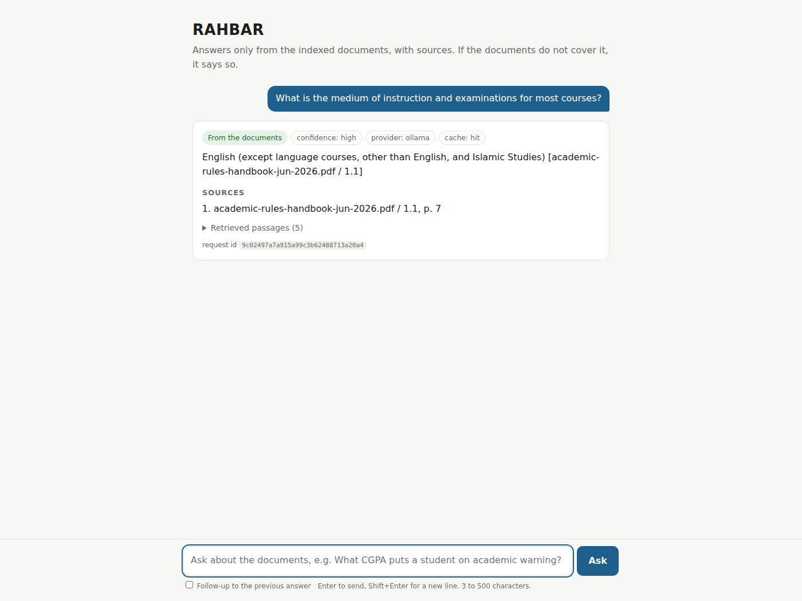

# Rahbar: portfolio guide

Rahbar is a completed academic team project for answering questions from public
FAST-NUCES policies. It combines a Python backend with retrieval, evaluation and
container orchestration. Completion is reported by the owner; the evidence below
identifies what was actually verified and at which revision.

## What to inspect

| Area | Implementation and evidence |
|---|---|
| API design | [FastAPI routes](../api/app/routes), request schemas, provider interfaces, health/readiness and metrics |
| Document ingestion | [Indexer pipeline](../indexer/pipeline), OCR/extraction, chunk metadata and corpus provenance |
| Retrieval and answers | Version-aware Chroma retrieval, citation validation, abstention and injection safeguards; [answer pipeline ADR](adr/0003-answer-pipeline.md) |
| Cache consistency | Shared Redis cache with published index generation in cache keys; [pipeline](PIPELINE.md) |
| Deployment | [Kubernetes manifests](../k8s), separate indexer Job/CronJob, persistent stores and dedicated service accounts |
| Engineering evaluation | [Failure analysis](FAILURE-ANALYSIS.md), [engineering notes](ENGINEERING-NOTES.md), committed baseline/results and CI gates |

## Recorded verification

The [real-corpus audit](https://github.com/rayyanhasan899/Rahbar/actions/runs/42308165966)
passed at source `4917e45`. The committed [golden results](../eval/results.json)
record recall@5 of **84.62%**, citation validity of **100%**, and correct refusal
of **both must-abstain cases**. These are small-benchmark measurements, not a
claim that every answer is correct: eight of fifteen responses supplied citations,
and other responses included safe refusals/fallbacks. Citation validity does not
by itself establish semantic correctness.

The reviewed release `f6c702b` passed [CD run 42341465116](https://github.com/rayyanhasan899/Rahbar/actions/runs/42341465116).
The subsequent documentation merge `1eec108` also passed
[CD run 42380217904](https://github.com/rayyanhasan899/Rahbar/actions/runs/42380217904).
CD publishes SHA-tagged images and validates deployment in an ephemeral cluster;
this does not provide a permanent public demo.

This existing screenshot comes from the recorded `4917e45` audit, not a fresh
execution of the portfolio documentation branch.

## Scope and limitations

- The successful real-generation audit used a larger-memory environment. The
  documented 8 GB Windows laptop indexed the corpus but encountered model-memory
  failures and returned safe fallbacks. See [runbook](RUNBOOK.md).
- Hosted-provider support has mocked tests; no independently verified live hosted
  deployment is claimed. There is no public hosted application.
- Public policy documents retain their original rights and are fetched separately.
  The existing [MIT license](../LICENSE) covers project code.
- This is team work with substantial disclosed AI assistance. See
  [authorship and AI usage](AI-USAGE.md); commit author fields do not establish
  independent handwritten implementation or individual contribution percentages.
- Historical requirement reports and experiment failures remain intact. The
  owner's completion update does not independently verify Classroom submission.

For setup, use the [README](../README.md) and [runbook](RUNBOOK.md). No cluster,
model service, credentials or machine settings need to be changed to review the
code and recorded evidence.
